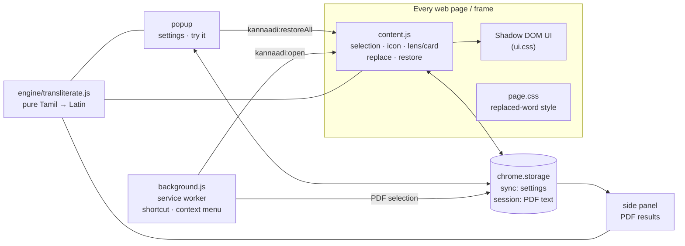

# Kannaadi (கண்ணாடி)

**Read Tamil script in English letters, right where it is on the page.**
Select Tamil text in Chrome, tap the small glass icon (or press <kbd>Alt</kbd>+<kbd>Shift</kbd>+<kbd>T</kbd>), and a frosted-glass lens slides over the text showing it in Latin letters. *Kannaadi* means "glass" or "mirror" in Tamil: the script on one side, its reflection in English letters on the other.

| Tamil | Tanglish (default) | Casual | ISO 15919 |
| --- | --- | --- | --- |
| வணக்கம் | vanakkam | vanakkam | vaṇakkam |
| நன்றி | nandri | nandri | naṉṟi |
| அம்மா | ammaa | amma | ammā |
| பச்சை | pachchai | pachai | paccai |
| பத்தி / பட்டி | paththi / patti | paththi / patti | patti / paṭṭi |
| ஜூலை (an English word) | july | july | jūlai |

It runs entirely in your browser: no servers, no accounts, no tracking, no build step.

---

## Contents

- [Features](#features)
- [Install](#install)
- [Using it](#using-it)
- [How it works](#how-it-works)
  - [Architecture](#architecture)
  - [The transliteration engine](#the-transliteration-engine)
  - [From selection to lens](#from-selection-to-lens)
  - [Replace and restore](#replace-and-restore)
  - [PDFs and frames](#pdfs-and-frames)
- [Spelling styles and how they were tuned](#spelling-styles-and-how-they-were-tuned)
- [Tech stack](#tech-stack)
- [Permissions and privacy](#permissions-and-privacy)
- [Where it works](#where-it-works)
- [Project structure](#project-structure)
- [Development](#development)
- [Limitations](#limitations)
- [Roadmap](#roadmap)
- [Credits and data](#credits-and-data)

---

## Features

| | |
| --- | --- |
| **Glass icon** | Appears at the end of any Tamil selection, mouse or keyboard. |
| **Lens view** (default) | A liquid-glass pane laid exactly over the selected text, with the English letters on top at the page's own text size. Follows the text when you scroll, stays inside scroll boxes, and scrolls internally if the selection is taller than what you can see. |
| **Card view** | The same result in a small floating card beside the selection. |
| **Copy / Replace / 🔊** | Copy the English letters, swap them into the page, or hear the Tamil (when the OS has a Tamil voice). |
| **Per-word restore** | Every replaced word remembers its Tamil. Hover it to restore that one word or everything. A 6-second Undo restores the last batch. |
| **Native undo in editors** | In inputs, textareas and rich editors the replacement is typed in, so <kbd>Ctrl</kbd>+<kbd>Z</kbd> works. |
| **Three spelling styles** | Tanglish (tuned on real data), Casual (lighter) and ISO 15919 (academic). |
| **Loanwords** | English words written in Tamil script keep their English spelling (ஜூலை → july, சென்னை → chennai). |
| **Right-click menu** | "Transliterate with Kannaadi". |
| **PDF side panel** | In Chrome's built-in PDF viewer, the right-click result opens in a side panel. |
| **Light and dark** | Follows your system theme. |

## Install

Kannaadi is not on the Chrome Web Store yet. To load it in developer mode:

1. `git clone https://github.com/PravinRaj01/kannaadi.git`
2. Open `chrome://extensions` and switch on **Developer mode** (top right).
3. Click **Load unpacked** and choose the cloned folder.
4. Pin it from the puzzle-piece menu so the **க** icon is visible.

Works in Chrome and other Chromium browsers (Edge, Brave, Arc) that support Manifest V3 and the side panel API (Chrome 116+).

## Using it

1. Select Tamil text on any page.
2. Click the glass **க** icon that appears, or press <kbd>Alt</kbd>+<kbd>Shift</kbd>+<kbd>T</kbd>.
3. Use the toolbar under the lens: **Copy**, **Replace**, **Card** (switch view), **🔊**, **✕**. <kbd>Esc</kbd> or clicking elsewhere closes it.

Open the toolbar popup to choose the spelling style and view, turn the auto-icon off, try text in a scratch box, restore all replaced Tamil on the page, or open the side panel.

> If another app owns <kbd>Alt</kbd>+<kbd>Shift</kbd>+<kbd>T</kbd>, Chrome silently leaves the shortcut unassigned. Kannaadi still listens for it inside web pages, and the popup tells you when Chrome did not assign it. Set your own at `chrome://extensions/shortcuts`.

A test page with paragraphs, formatted text, a scroll box, inputs and an editable area is in [demo/index.html](demo/index.html). For `file://` pages, turn on **Allow access to file URLs** in the extension's details.

---

## How it works

### Architecture

Kannaadi is a plain Manifest V3 extension with no bundler and no dependencies. One pure engine file is shared by every part.



| Piece | Runs in | Job |
| --- | --- | --- |
| `src/engine/transliterate.js` | content script, popup, side panel, Node | Tamil → Latin. Pure function, no DOM. Exposes `globalThis.Kannaadi` in the browser and `module.exports` in Node. |
| `src/content/content.js` | every frame of every page | Watches selections, draws the icon, lens, card, chip and pill, and does replace and restore. |
| `src/content/ui.css` | inside a closed Shadow DOM | All glass styling, isolated from page CSS in both directions. |
| `src/content/page.css` | the page itself | Only styles `<kannaadi-w>` (replaced words). |
| `src/background.js` | service worker | Turns the keyboard command and right-click into messages, and routes PDF selections to the side panel. |
| `src/popup/` | toolbar popup | Settings, live samples, "Try it", Restore, Side panel. |
| `src/panel/` | Chrome side panel | Shows the transliteration of text selected in a PDF, or pasted text. |

### The transliteration engine

[`src/engine/transliterate.js`](src/engine/transliterate.js) is about 300 lines and has no dependencies.

**1. Normalize and tokenize.** Input is NFC-normalized, so decomposed vowel signs like `ெ`+`ா` become `ொ`. It is then split into tokens:

| Token | Example | Meaning |
| --- | --- | --- |
| independent vowel | அ ஆ இ … ஔ | a vowel at the start of a syllable |
| consonant + vowel sign | கா கி கு … | `pure: false`, `sign` = the vowel sign |
| consonant + virama (், U+0BCD) | க் | `pure: true`, a dead consonant with no vowel |
| bare consonant | க | `pure: false`, inherent *a* |
| anything else | spaces, Latin, punctuation | passed through untouched (Tamil digits ௧௨௩ become 123) |

Grantha letters (ஜ ஷ ஸ ஹ ஶ), the aytham ஃ and the anusvara ஂ are handled too.

**2. Spell each consonant by its context.** Tamil writes one letter where English hears two sounds: க is *k* at the start of a word and *g* between vowels. Each consonant is classified by what comes before it in the same word:

| Position | Rule of thumb | Example |
| --- | --- | --- |
| `Init` | word start, or after a non-nasal consonant | **க**டல் → **k**adal |
| `Med` | right after a vowel | ப**க**ல் → pa**g**al |
| `Nas` | after a nasal (ங் ஞ் ண் ந் ம் ன்) | த**ங்க**ம் → tha**ng**am, ம**ஞ்ச**ள் → ma**nj**al |
| `Gem` | second half of a doubled consonant | வண**க்க**ம் → vana**kk**am, ப**த்**தி → pa**thth**i |

A doubled consonant prints nothing for its first half and the full pair (`kk`, `thth`, `ttr`) for its second. Special clusters are handled the same way: ன்ற → `ndr` (நன்றி → nandri), ற்ற → `ttr`, ஃப → `f`.

**3. Look the spelling up in a style table.** Every informal choice (about 30 of them) lives in `STYLES`: `kMed: 'g'`, `thGem: 'thth'`, `aaFinal: 'aa'`, and so on. `OPTIONS` lists the allowed alternatives for each key. That is what makes the styles tunable against real data (see below).

**4. Loanwords first.** For the two informal styles, a whole Tamil word that is in a small hand-written list (`LOANWORDS`: months, places, common English words, names) is replaced by its English spelling before the rules run.

**5. ISO 15919** skips the context rules and uses a straight one-to-one table with diacritics.

Two properties the rest of the extension relies on, both covered by tests:

- Context never crosses a non-Tamil character, so **transliterating word by word gives exactly the same result as transliterating the whole text**. Per-word restore depends on this.
- `splitTamil(text)` returns alternating Tamil and non-Tamil runs, used for per-word wrapping and loanword lookup.

### From selection to lens

1. **Detect.** `selectionchange` (debounced 250 ms), `mouseup` and `keyup` call `update()`. It snapshots the selection as either a DOM `Range` (a clone, so later selection changes don't affect it) or a text field plus offsets. The icon is shown only if the text contains Tamil (U+0B80–U+0BFF).
2. **Isolate.** All UI lives in a closed Shadow DOM attached to one `<div id="kannaadi-root">` on `<html>`. Its stylesheet is loaded from the extension (`web_accessible_resources`), and the host stays hidden until the stylesheet has loaded, so nothing flashes unstyled.
3. **Open.** Icon click, the keyboard command and the right-click all call `openView()`, which dedupes double triggers within 300 ms and picks lens or card from settings.
4. **Lay out the lens.**
   - The lens covers the union of `range.getClientRects()`, clipped to the visible area: the viewport intersected with every ancestor that has `overflow` set.
   - If the selection is partly scrolled out of view, the lens keeps the visible size and scrolls internally.
   - If the selection is fully out of view, the lens hides.
   - Font size and line height are copied from the page (clamped to 13–26 px and 1.25–1.6×).
   - On `scroll` (captured, so inner scroll boxes count too) and `resize`, layout is recomputed once per animation frame.
5. **Glass.** `backdrop-filter: blur() saturate() contrast()` frosts the Tamil underneath. Gradient fills, inset highlights and a specular `::before` sheen give the liquid-glass look. A `prefers-color-scheme: dark` palette and `prefers-reduced-motion` are respected.

### Replace and restore

There are three strategies, chosen by where the selection is:

| Where | How it replaces | How you get the Tamil back |
| --- | --- | --- |
| Normal page text | Each intersected text node is split at the selection edges. Each Tamil word becomes `<kannaadi-w data-ta="வணக்கம்">vanakkam</kannaadi-w>`. | Hover a word for the chip with **↺ Restore** and **Restore all**, the popup's **Restore Tamil**, or the Undo pill. Unwrapping swaps the element back to a text node and calls `normalize()`. |
| `<input>` / `<textarea>` | `document.execCommand('insertText')` over the selected range, which goes through the browser's own editing and undo stack (falls back to `setRangeText` + an `input` event). | <kbd>Ctrl</kbd>+<kbd>Z</kbd>, or the Undo pill (which types the original back). |
| `contenteditable` editors | Same `insertText` approach, per text node. No wrapper elements, so nothing leaks into what you are writing. | <kbd>Ctrl</kbd>+<kbd>Z</kbd>, or the Undo pill. |

### PDFs and frames

- **Frames.** The content script runs in all frames (`all_frames`), including `about:blank`, `blob:` and `srcdoc` frames (`match_about_blank`, `match_origin_as_fallback`). Web EPUB readers render chapters in such frames. The keyboard command is broadcast to every frame, and only the frame holding a Tamil selection reacts.
- **Chrome's PDF viewer** does not run extension content scripts.
  - Chrome still passes `selectionText` to context-menu handlers there. When the page looks like a PDF, `background.js` calls `chrome.sidePanel.open()` synchronously inside the click handler (side panels need a user gesture) and stores the text in `chrome.storage.session`.
  - The side panel listens for that and renders the result.

---

## Spelling styles and how they were tuned

| Style | What it optimizes for |
| --- | --- |
| **Tanglish** (default) | The spelling real people type most often, while keeping Tamil distinctions readable: long and short vowels stay apart (`aa` / `a`), soft dental and hard retroflex doubles stay apart (`paththi` / `patti`). |
| **Casual** | Tanglish plus only the lightenings that cost under 1% of accuracy: final long *aa* (`amma`), `kaatru`, `pachai`. Every other lightening cost between 1 and 12%. |
| **ISO 15919** | Academic transliteration with diacritics. One Tamil letter maps to one Latin letter. |

**Where the numbers come from.** The informal styles are tuned against the [Dakshina](https://github.com/google-research-datasets/dakshina) Tamil romanization lexicon. In that dataset, native speakers were shown a Tamil word and typed it in Latin letters, and each spelling comes with a count. [`scripts/eval.js`](scripts/eval.js):

- scores the engine (share of attestations matched, top-1, any-match);
- tunes every `STYLES` key by coordinate descent over its `OPTIONS`, using the train split, with dev and test held out;
- lists the most common words we still spell differently.

| Metric | Before tuning | Tanglish | Casual |
| --- | --- | --- | --- |
| Attested spellings matched (train) | 35.4% | 41.2% | 39.9% |
| Attested spellings matched (held-out test) | | 41.5% | |
| Most common spelling matched, top-1 (test) | | 58.4% | |
| Any attested spelling matched (test) | | 81.1% | |

Why "only" about 42%:

- People disagree on spelling almost everywhere.
- The lexicon is full of English names written in Tamil script whose top spelling is the English one (`mayor`, `stephan`), which letter rules cannot produce.

Some concrete outcomes of the tuning:

- **பத்தி stays `paththi`.** `pathi` and `patthi` each scored about 5 points worse.
- **த between vowels became `th`** (`athu`, `antha`) instead of `dh`.
- **ற்ற became `ttr`** (`kaattru`).

The dataset is used only to measure and tune. It is not in this repo and not in the extension.

---

## Tech stack

| Layer | Choice | Why |
| --- | --- | --- |
| Platform | Chrome extension, **Manifest V3** | Service worker background, current Chrome Web Store requirement. |
| Language | **Vanilla JavaScript** (ES2020+), no framework, no bundler | Nothing to build; the source you read is the source that runs. |
| UI isolation | **Shadow DOM** (closed) + one injected stylesheet | Page CSS cannot break the glass, and the glass cannot break the page. |
| Styling | Plain CSS: `backdrop-filter`, gradients, custom properties, `:has()`, `prefers-color-scheme`, `prefers-reduced-motion` | The liquid-glass look without images or libraries. |
| Chrome APIs | `storage` (sync and session), `contextMenus`, `commands`, `sidePanel`, `runtime` and `tabs` messaging | Settings, right-click, keyboard shortcut, PDF results. |
| Speech | Web Speech API (`speechSynthesis`, `ta` voices) | 🔊 only appears when the OS has a Tamil voice. |
| Engine | Hand-written rule engine with a data-tuned style table | Tamil script is regular enough that rules beat a model on size, speed and privacy for this direction. |
| Tests | Node's built-in `node:test` | Zero dependencies. |
| Data tooling | Node script against the Dakshina lexicon | Measures and tunes spellings offline. |
| Icons | PowerShell + `System.Drawing` | Regenerates the PNG icons with the Tamil letter க. |

## Permissions and privacy

| Permission | Used for |
| --- | --- |
| Content script on `<all_urls>` | Detecting Tamil selections and drawing the lens on any page. |
| `storage` | Your three settings (`scheme`, `view`, `autoIcon`) in `chrome.storage.sync`, and the last PDF selection in `chrome.storage.session` (cleared when the browser closes). |
| `contextMenus` | The "Transliterate with Kannaadi" right-click item. |
| `sidePanel` | Showing results for Chrome's PDF viewer. |

Kannaadi makes **no network requests**. Selected text never leaves your machine, and there is no analytics.

## Where it works

| Where | Support |
| --- | --- |
| Normal web pages, blogs, news, Wikipedia | Everything: lens, card, replace, restore |
| Web readers built on PDF.js (PDFs with a text layer) | Lens and card. Replace is not useful there: the visible page is an image and the text layer is invisible. |
| Web EPUB readers (chapters in iframes) | Everything, including `blob:` and `srcdoc` frames |
| Chrome's built-in PDF viewer | Select, right-click → **Transliterate with Kannaadi** → result opens in the side panel |
| Scanned PDFs, images, canvas-rendered text (Kindle Cloud Reader, Google Docs) | Not yet: there is no real text to select |
| Chrome Web Store, `chrome://` pages | No: Chrome blocks extensions there |

## Project structure

```
kannaadi/
├── manifest.json               MV3 manifest: content scripts, permissions, command, side panel
├── src/
│   ├── engine/
│   │   └── transliterate.js    tokenizer, context rules, STYLES/OPTIONS, LOANWORDS, ISO table
│   ├── content/
│   │   ├── content.js          selection snapshot, icon, lens/card, chip, pill, replace/restore
│   │   ├── ui.css              glass styles (shadow root)
│   │   └── page.css            <kannaadi-w> replaced-word style (page)
│   ├── background.js           command + context menu → message, PDF → side panel
│   ├── popup/                  popup.html / .css / .js: settings and tools
│   └── panel/                  panel.html / .css / .js: side panel (reuses popup.css)
├── scripts/
│   ├── eval.js                 measure and tune spellings against Dakshina
│   └── make-icons.ps1          regenerate icons/
├── icons/                      16, 32, 48, 128 px
├── demo/index.html             manual test page
└── test/engine.test.js         engine unit tests (node:test)
```

## Development

Requirements: Node 18+ (tests use `node:test`) and Chrome or another Chromium browser.

```bash
npm test                  # 47 engine tests, no install needed
npm run icons             # Windows only: regenerate icons/
```

**Reloading after changes.** Click the refresh arrow on the extension card in `chrome://extensions`, then reload the tab you are testing.

**Debugging:**

| What | Where to look |
| --- | --- |
| Content script | The page's DevTools console |
| Service worker | **Inspect views: service worker** on the extension card |
| Popup | Right-click the popup → **Inspect** |

**Evaluating spelling changes.** Download `ta/lexicons/ta.translit.sampled.{train,dev,test}.tsv` from the [Dakshina release](https://github.com/google-research-datasets/dakshina) (CC BY-SA 4.0; keep it outside the repo), then:

```bash
node scripts/eval.js path/to/ta.translit.sampled.train.tsv --dev path/to/ta.translit.sampled.dev.tsv           # score
node scripts/eval.js path/to/ta.translit.sampled.train.tsv --dev path/to/ta.translit.sampled.dev.tsv --tune    # re-tune Tanglish
node scripts/eval.js path/to/ta.translit.sampled.train.tsv --worst 40                                          # most common misses
```

`--tune` writes the result to `scripts/.tuned-tanglish.json` (git-ignored). Copy the values you agree with into `STYLES` and update the tests.

**Manual checklist (demo page):**

1. Selection → icon → lens over the text.
2. Lens follows the scroll box in section 5.
3. Replace, then hover a word → Restore one, then Restore all.
4. Input, textarea and editable area: Replace, then <kbd>Ctrl</kbd>+<kbd>Z</kbd>.
5. <kbd>Alt</kbd>+<kbd>Shift</kbd>+<kbd>T</kbd>.
6. Right-click menu.
7. Popup style and view switches.
8. Dark mode.

## Limitations

- **Tamil script → Latin only.** Typing Tanglish to get Tamil is not supported yet.
- **No text to select, no transliteration.** Scanned PDFs and images need OCR, which is planned.
- **Replace edits the live DOM.** Pages that re-render (some React apps) may undo it.
- **Tamil PDFs made with legacy fonts** (TSCII, Bamini) often have a broken text layer, so the selected text itself is garbled before Kannaadi sees it.
- **Lens refraction** is simulated with blur and highlights. A true SVG displacement refraction was left out to keep the blur reliable everywhere.

## Roadmap

- **Snip and read.** Draw a box anywhere, including Chrome's PDF viewer, scanned PDFs and images, and get on-device OCR plus a lens.
- **A bundled PDF.js viewer**, so the full lens works on PDFs.
- **Tanglish → Tamil** with a small on-device model (WASM / WebGPU). No server.
- A user-editable loanword dictionary and a per-site on/off list.
- Firefox build.

## Support

Kannaadi is free and open source. If it saves you time, you can support its development:

[](https://buymeacoffee.com/pravinraj)
[](https://ko-fi.com/pravinraj)

Bug reports, Tamil spelling corrections and ideas are just as welcome: [open an issue](https://github.com/PravinRaj01/kannaadi/issues). See also the [privacy policy](PRIVACY.md).

## Credits and data

- [Dakshina dataset](https://github.com/google-research-datasets/dakshina) (Google Research, CC BY-SA 4.0): used offline to tune and evaluate spellings. Not redistributed.
- [ISO 15919](https://en.wikipedia.org/wiki/ISO_15919) for the academic scheme.

## License

[MIT](LICENSE)
